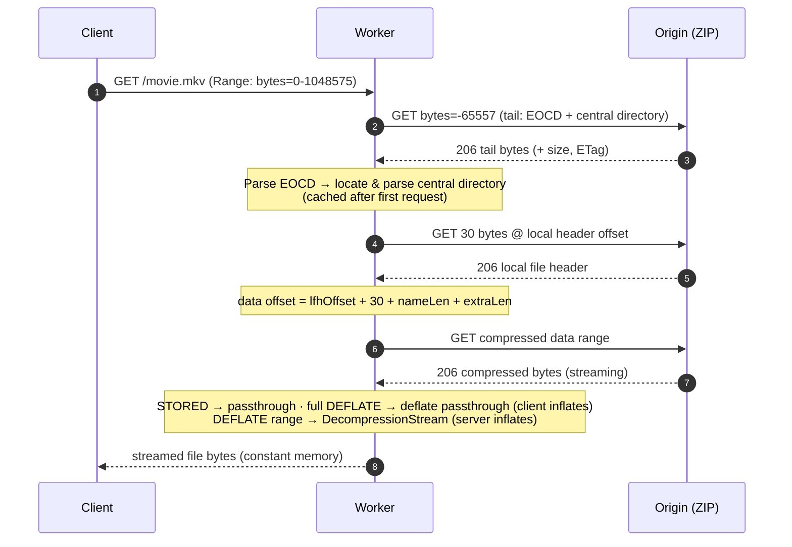

# Archwright

**Stream individual files out of a remote ZIP archive at the edge — no
extraction, no storage, constant memory.**

A production-grade [Cloudflare Workers](https://developers.cloudflare.com/workers/)
reference implementation. Point it at a remote `archive.zip` and it exposes every
file inside as a standalone, seekable, streamable download — the client never
knows the bytes came from inside a ZIP.

```
Remote archive.zip                          Your Worker
├── movie1.mkv       ─────────────────▶     GET /movie1.mkv      (streamed)
├── movie2.mkv       ─────────────────▶     GET /movie2.mkv      (streamed)
└── movie3.mkv       ─────────────────▶     GET /movie3.mkv      (streamed)
```

The Worker **never downloads the whole archive, never writes to storage, and
never buffers a file**. It reads the ZIP's index with a couple of HTTP range
requests and streams the one file you asked for straight through — so a 2.5 GB
entry inside a 50 GB archive is served in a 128 MB isolate without breaking a
sweat.

- ✅ **Built-in web UI** — paste a link, browse the files, download one or many
- ✅ **Play media from inside the archive** — stream and scrub a video without extracting it; sibling `.srt` subtitles are found and converted to WebVTT automatically
- ✅ **Combined download** — select multiple files and stream them back as one **ZIP or TAR**, at any size (zero re-compression, native byte pumps)
- ✅ **Bundles (the reverse direction)** — hand it many remote file URLs and get one permanent `/bundle/{code}.tar` or `.zip`; nothing is stored, everything streams
- ✅ **R2 as a source** — address bucket objects as `r2://{key}`, for archives *and* bundle files: no external subrequests (so ~1,000 files per bundle on Free instead of ~48) and no egress cost
- ✅ **Seekable generated archives** — bundles answer `Range` requests, so a multi-gigabyte download **resumes** after a dropped connection, works with download managers, and can be pulled in parallel chunks
- ✅ **Permanent short links** — turn a giant signed archive URL into a tidy, shareable `/zfile/{code}` (browse) + `/sfile/{code}/{file}` (download); the code is stable across re-signs (KV-backed, auto-loads in the UI)
- ✅ Zero runtime dependencies · ~30 KiB gzipped bundle
- ✅ Works on the **Free** and **Paid** plans — full STORED **and DEFLATE** downloads stream at any size on Free (zero-copy, ~0 CPU)
- ✅ Full ZIP support: **STORED, DEFLATE, ZIP64, data descriptors, UTF-8/CP437 names**
- ✅ HTTP done right: **byte ranges (206/416), conditional requests (304), `If-Range`, HEAD, CORS, strong ETags**
- ✅ Native streaming inflate via `DecompressionStream('deflate-raw')`, plus a zero-CPU `Content-Encoding: deflate` passthrough for large full downloads — no JS decompressor
- ✅ SSRF allowlist, ZIP-bomb guards, signed references, structured logs & metrics
- ✅ 190+ tests, benchmarks, CI, and thorough docs

---

## How it works

A ZIP file's directory lives at the **end** of the archive. So instead of
downloading gigabytes, the Worker fetches only what it needs, using HTTP `Range`
requests:



A cold download costs **~3 origin subrequests** (tail, local header, data). Once
the central directory is cached, repeat requests to the same archive skip
straight to the data. See [docs/architecture.md](docs/architecture.md) for the
full picture.

---

## Web UI

Out of the box the Worker serves a small, dependency-free page at `/`:

1. **Paste** a link to any `.zip` (in open mode) — or it auto-loads the archive
   the deployment is configured for.
2. The files inside are **listed** (name, size, type) — read straight from the
   archive's index, without downloading it.
3. **Select** one file, several, or all.
4. **Download** — each file individually, or the whole selection repackaged into a
   single **ZIP or TAR** streamed on the fly (no re-compression, exact size known
   up front, no size ceiling).

A second tab goes the **other way**: paste a list of remote file URLs and get one
permanent link that streams them back as a single `.tar` or `.zip`.

To accept arbitrary pasted links, set `ALLOW_ANY_ARCHIVE_HOST=true` (this makes
the Worker a public proxy for any public host — private/reserved IPs stay
blocked). Otherwise restrict it with `ALLOWED_ARCHIVE_HOSTS` or signed links. Set
`SERVE_UI=false` to serve a JSON index instead of the page.

## Quick start

```bash
git clone https://github.com/your-org/archwright
cd archwright
npm install
npm run cf-typegen            # generate Worker types

# Point it at an archive and run locally
cp .dev.vars.example .dev.vars   # set ARCHIVE_URL
npm run dev

# In another terminal
curl http://localhost:8787/__/list
curl -O http://localhost:8787/your-file.mkv
```

Deploy:

```bash
npx wrangler deploy
```

Inspect any remote ZIP without deploying anything:

```bash
node scripts/probe-archive.mjs "https://storage.googleapis.com/bucket/archive.zip"
```

---

## Endpoints

| Method       | Path                    | Description                                                 |
| ------------ | ----------------------- | ----------------------------------------------------------- |
| `GET`        | `/`                     | Browser UI (or a JSON index when `SERVE_UI=false`)          |
| `GET`/`HEAD` | `/{entryPath}`          | Download an entry (streamed; supports `Range`)              |
| `GET`/`HEAD` | `/__/zip?path=…&path=…` | Download the selected files as one combined ZIP             |
| `GET`/`HEAD` | `/__/tar?path=…&path=…` | Same selection as a TAR                                     |
| `POST`       | `/__/bundle`            | Bundle many remote file URLs into one permanent archive     |
| `POST`       | `/__/bundle/{code}/prepare` | Compute the CRC-32s a ZIP bundle needs (resumable)      |
| `GET`/`HEAD` | `/bundle/{code}.tar`    | Download a bundle as TAR (ready immediately, any size, resumable) |
| `GET`/`HEAD` | `/bundle/{code}.zip`    | Download a bundle as ZIP (after prepare; resumable)         |
| `GET`        | `/__/list`              | List entries (paginated, `?prefix=`, `?limit=`, `?cursor=`) |
| `GET`        | `/__/meta/{entryPath}`  | Metadata for one entry (size, method, ETag, type)           |
| `GET`        | `/__/play/{entryPath}`  | Player page for an audio/video entry (streams, seeks, subtitles) |
| `GET`        | `/__/subtitle/{entryPath}` | A `.srt`/`.vtt` entry served as WebVTT                   |
| `GET`        | `/__/health`            | Liveness probe (never touches the origin)                   |
| `GET`        | `/__/version`           | Version, mode, effective limits, detected features          |
| `OPTIONS`    | `*`                     | CORS preflight                                              |

The control-plane prefix (`__`) is configurable. In multi-archive mode, prefix
data-plane paths with `/a/{ref}`. See [docs/api.md](docs/api.md).

---

## Configuration

All settings are `vars` in `wrangler.jsonc` (or secrets). Everything has a safe
default; invalid values degrade to the default rather than crashing.

| Variable                      | Default    | Purpose                                                               |
| ----------------------------- | ---------- | --------------------------------------------------------------------- |
| `ARCHIVE_URL`                 | —          | Set → single-archive mode; empty → multi-archive mode                 |
| `ALLOWED_ARCHIVE_HOSTS`       | —          | SSRF allowlist (comma-separated hosts); required for multi-archive    |
| `ARCHIVE_SIGNING_SECRET`      | —          | Enable HMAC-signed references (secret)                                |
| `CONTROL_PREFIX`              | `__`       | Path prefix reserving the control plane                               |
| `CORS_ALLOW_ORIGIN`           | `*`        | `*`, or a comma-separated origin allowlist                            |
| `CONTENT_DISPOSITION`         | `attachment` | Default disposition: `attachment` (bare link downloads) or `inline` (browser preview). Override per request with `?inline` / `?download`. |
| `SERVE_UI`                    | `true`     | Serve the browser UI at `/` (else a JSON index)                       |
| `ALLOW_ANY_ARCHIVE_HOST`      | `false`    | Multi-archive: accept **any public host** (private IPs still blocked) |
| `MAX_ZIP_ENTRIES`             | `64`       | Max files in one combined-ZIP download                                |
| `SHORTLINK_TTL_SECONDS`       | `0` (perm) | Short-link lifetime; `0` = permanent (needs the `LINKS_KV` binding)   |
| `R2_PREFIX`                   | — (all)    | Restrict `r2://` sources to keys under this prefix                    |
| `CACHE_TTL_SECONDS`           | `3600`     | Central-directory cache TTL (`0` disables)                            |
| `ORIGIN_TIMEOUT_MS`           | `15000`    | Origin header/TTFB timeout (body streaming is unbounded)              |
| `ORIGIN_RETRIES`              | `2`        | Automatic retries on transient origin failures                        |
| `MAX_CENTRAL_DIRECTORY_BYTES` | `67108864` | Cap on buffered central-directory size                                |
| `MAX_ENTRY_COUNT`             | `100000`   | Cap on entries parsed                                                 |
| `MAX_UNCOMPRESSED_BYTES`      | `0` (off)  | Reject entries larger than this                                       |
| `MAX_COMPRESSION_RATIO`       | `0` (off)  | Reject entries above this ratio (ZIP-bomb guard)                      |

Optional bindings (auto-detected): `R2_BUCKET` (`r2://` sources), `LINKS_KV` (short links — `/__/shorten`,
`/zfile/{code}`, `/sfile/{code}`), `METADATA_KV` (cross-colo directory cache),
`METRICS` (Analytics Engine).

---

## Plan compatibility

| Capability                                 |     Free     |  Paid / Standard   |
| ------------------------------------------ | :----------: | :----------------: |
| STORED entries (any size)                  |      ✅      |         ✅         |
| DEFLATE full download (any size)           |      ✅¹     |         ✅         |
| DEFLATE ranges / combined ZIP              | ⚠️ ~100 MB²  | ✅ up to 5 min CPU |
| Range requests, streaming, constant memory |      ✅      |         ✅         |
| Central-directory cache (Cache API, memo)  |      ✅      |         ✅         |
| KV / Analytics Engine bindings             |   optional   |      optional      |

¹ A **full** DEFLATE download is passed through untouched under `Content-Encoding:
deflate` and inflated by the client, so the Worker spends ≈ 0 CPU and the entry
streams to completion at any size — a 2.4 GB entry costs ~12 ms CPU on Free
(default; disable with `DEFLATE_PASSTHROUGH=false`). Like STORED, it is a
zero-copy origin passthrough.

² The paths that must touch the bytes in-isolate — a DEFLATE **range** (an encoded
body can't be seeked, so it's inflated server-side) or a **combined** `/__/zip`
(entries are re-framed through a stream writer) — cost CPU proportional to bytes
and hit the Free plan's ~2 s budget around ~100–125 MB. Paid raises this to 5 min
(`limits.cpu_ms`). See [docs/performance.md](docs/performance.md) and
[docs/limitations.md](docs/limitations.md).

---

## Why this design

- **Constant memory.** Bodies always stream (`ReadableStream` → client), so
  memory is independent of file size. A ZIP bomb cannot OOM the isolate.
- **Native decompression.** ZIP method 8 is raw DEFLATE, decoded by the runtime's
  `DecompressionStream('deflate-raw')` — fast (C++/zlib), zero bundle cost, full
  backpressure. No `pako`/`fflate`.
- **Correctness first.** The data offset is computed from the _local_ file
  header (whose extra-field length routinely differs from the central
  directory's — a bug in many implementations), sizes come from the central
  directory when a data descriptor is present, and every byte read is
  bounds-checked.
- **Dependency inversion.** The ZIP layer is written against a `RangeReader`
  interface; production uses HTTP ranges, tests use an in-memory buffer — so the
  whole stack is verified without a network.

Full rationale in the [Architecture Decision Records](docs/adr/).

---

## Project structure

```
src/
├── index.ts            # Worker entry (fetch handler)
├── app.ts              # Assembly: config, deps, middleware pipeline
├── routes/             # Route resolution (single/multi mode) + dispatch
├── middleware/         # error boundary, logging, CORS, security headers
├── handlers/           # health, version, list, meta, download, options, root
├── services/           # archive opening, entry validators
├── zip/                # EOCD, central directory, local header, ZIP64, CRC, names
├── http/               # RangeReader (+ HTTP impl), range/conditional parsing
├── streaming/          # inflate, range slicing, byte metering, pipeline
├── cache/              # Cache API / KV / memo, central-directory cache
├── security/           # SSRF, sanitisation, ZIP-bomb guards, HMAC signing
├── validation/         # request path normalisation
├── observability/      # structured logger, metrics
├── config/             # env → typed Config
├── constants/  types/  errors/  utils/
tests/          # unit + integration (Node runtime, DI, real fixtures)
benchmarks/     scripts/     docs/     examples/     .github/
```

---

## Development

```bash
npm run dev            # local server (wrangler dev)
npm run check          # typecheck + lint + format + tests
npm test               # vitest
npm run test:coverage  # with coverage thresholds
npm run build          # wrangler dry-run bundle
```

The test suite runs in plain Node — the application takes its origin fetcher,
cache, and clock via dependency injection, so the real request pipeline is
exercised end to end without `workerd` or a network.

---

## Documentation

| Doc                                                                                          |                                                           |
| -------------------------------------------------------------------------------------------- | --------------------------------------------------------- |
| [Architecture](docs/architecture.md)                                                         | Components, request lifecycle, streaming & cache diagrams |
| [API reference](docs/api.md)                                                                 | Every endpoint, header, and status code                   |
| [Security](docs/security.md)                                                                 | Threat model and controls                                 |
| [Performance](docs/performance.md)                                                           | CPU/memory/latency analysis and tuning                    |
| [Deployment](docs/deployment.md)                                                             | Free vs Paid, bindings, custom domains                    |
| [Limitations](docs/limitations.md)                                                           | Honest boundaries and why                                 |
| [Troubleshooting](docs/troubleshooting.md) · [FAQ](docs/faq.md) · [Roadmap](docs/roadmap.md) |                                                           |
| [Audit](docs/audit.md)                                                                       | Production audit: findings & resolutions                  |
| [ADRs](docs/adr/)                                                                            | Design decisions with rationale                           |

---

## License

[MIT](LICENSE). This is a community reference implementation and is not an
official Cloudflare product.
