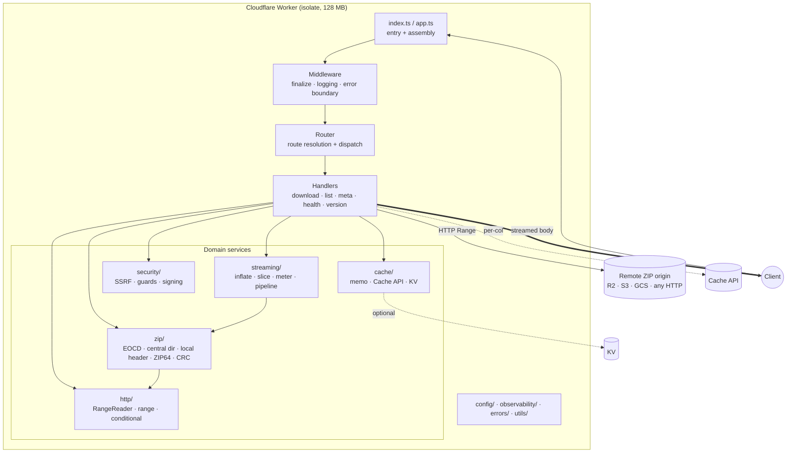
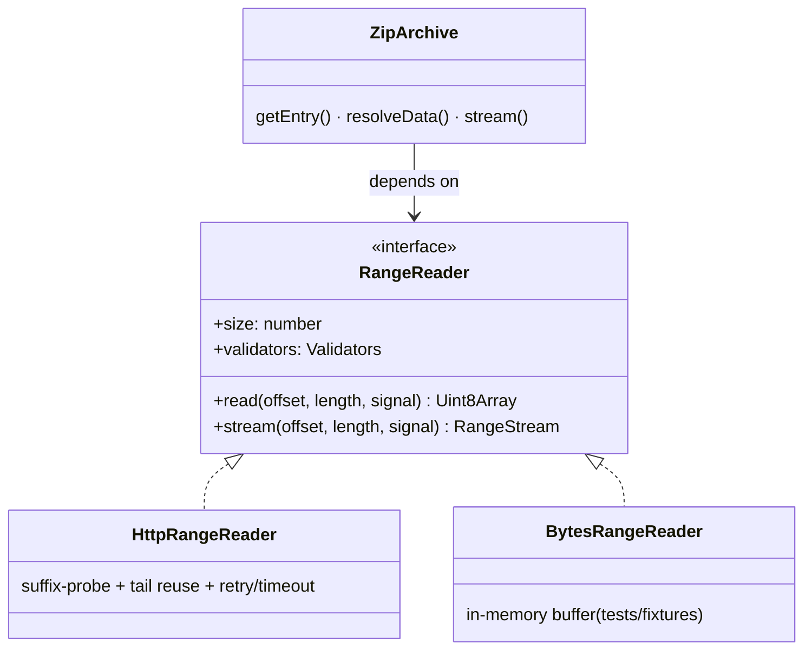
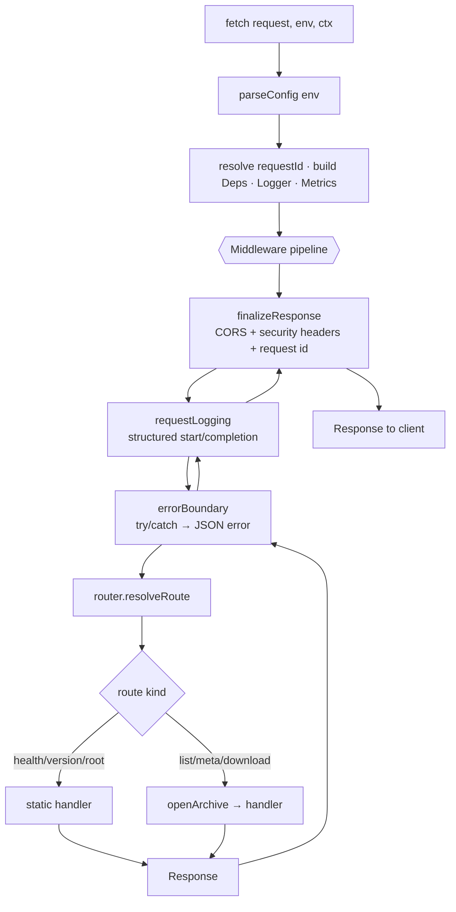
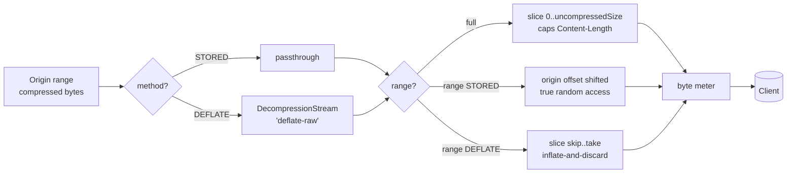
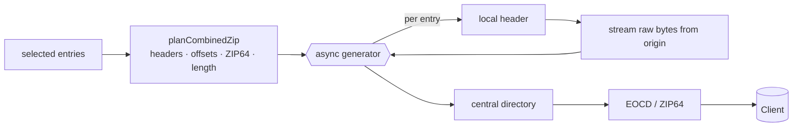
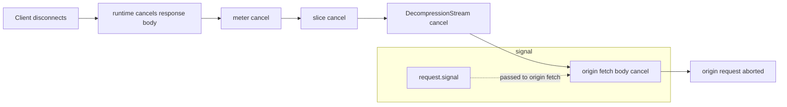

# Architecture

ZipStream is a layered Cloudflare Worker. Each layer has a single
responsibility, depends only on abstractions below it, and is independently
testable. This document covers the component structure, the request lifecycle,
the streaming pipeline, and the cache flow.

## Contents

- [Component overview](#component-overview)
- [Layered design & dependency inversion](#layered-design--dependency-inversion)
- [Request lifecycle](#request-lifecycle)
- [ZIP reading strategy](#zip-reading-strategy)
- [Streaming pipeline](#streaming-pipeline)
- [Cache flow](#cache-flow)
- [Abort & backpressure](#abort--backpressure)

---

## Component overview



The **data plane** (download) and **control plane** (list/meta/health/version)
share the same pipeline; only the terminal handler differs.

---

## Layered design & dependency inversion

The core abstraction is `RangeReader` — "random access over a byte source of
known size." The entire ZIP layer is written against it and knows nothing about
HTTP:



Because `ZipArchive` depends on the interface, production wires an
`HttpRangeReader` (HTTP ranges) while tests wire a `BytesRangeReader` (a real ZIP
built in memory). The same is true for the origin fetcher, the cache, and the
clock — all injected via `Deps`. That is why the full request pipeline is tested
in plain Node with no network and no `workerd`.

---

## Request lifecycle



`finalizeResponse` is outermost so it decorates **both** success and error
responses. `errorBoundary` normalises any thrown value into a uniform JSON error
and logs it against the request id (5xx at `error`, 4xx at `warn`, client abort
at `info`).

---

## ZIP reading strategy

Which parts of a ZIP need random access vs. streaming — and how ZipStream reads
each:

| Structure                | Location               | Access        | How                                   |
| ------------------------ | ---------------------- | ------------- | ------------------------------------- |
| End of Central Directory | last ≤ 65 557 bytes    | random        | suffix range (also yields size)       |
| ZIP64 EOCD (if present)  | pointed to by locator  | random        | in tail, or one small range           |
| Central Directory        | before EOCD            | random        | one range (often within the tail)     |
| Local File Header        | before each entry      | random        | 30-byte range → data offset           |
| **Entry data**           | after its local header | **streaming** | ranged stream → passthrough / inflate |

Two subtleties this implementation gets right and many do not:

1. **The data offset must come from the local file header**, whose name/extra
   lengths frequently differ from the central directory's:
   `dataOffset = localHeaderOffset + 30 + LFH.nameLen + LFH.extraLen`.
2. **When a data descriptor is present** (general-purpose flag bit 3), the local
   header's sizes and CRC are zero — the authoritative values are in the central
   directory.

---

## Streaming pipeline

The body is assembled as a chain of `ReadableStream` transforms. Nothing is
buffered; the runtime pulls from the origin only as fast as the client drains.



- **STORED + range** shifts the origin offset — the client's byte range maps
  directly onto the origin, giving true random access (ideal for video seeking).
- **DEFLATE + range** inflates from the start and slices out the window, then
  terminates (cancelling everything upstream). This is inherent to DEFLATE and
  documented as a limitation.
- **DEFLATE full** is capped at the declared uncompressed size, so the body can
  never exceed the `Content-Length` we advertised.

Because the central directory records the uncompressed size, **`Content-Length`
is always known** — even for DEFLATE entries — so clients get accurate progress
bars and the response is never chunked.

---

## Combined ZIP (the writer)

The multi-file download inverts the read path: `zip/zip-writer.ts` repackages a
selection of entries into a **new** ZIP that streams to the client. It copies
each entry's stored bytes verbatim (a DEFLATE entry stays DEFLATE — no inflate,
no deflate) and reuses the CRC and sizes from the source central directory. The
full byte layout — every local header, the central directory, the EOCD, and any
ZIP64 records — is computed up front by a pure `planCombinedZip`, which yields an
exact `Content-Length` before a byte is sent. Data is streamed per entry via the
same `RangeReader`, so memory stays constant regardless of the selection's size.



## Cache flow

The parsed central directory is cached at three tiers, consulted fastest-first.
The cache key folds in the origin validator (ETag/Last-Modified), so a changed
archive misses instead of serving a stale index.

```mermaid
flowchart TD
    REQ[openArchive] --> PROBE[HttpRangeReader.open<br/>suffix probe → size + validators + tail]
    PROBE --> KEY[key = url + '|' + etag]
    KEY --> L1{in-isolate memo?}
    L1 -->|hit| USE[ZipArchive ready]
    L1 -->|miss| L2{Cache API / KV?}
    L2 -->|hit| REHYDRATE[parse cached CD bytes → memo] --> USE
    L2 -->|miss| PARSE[read EOCD + central directory from origin]
    PARSE --> STORE[memo.set + background Cache write] --> USE
```

- **L1 — in-isolate memo:** a bounded TTL/LRU map. Survives across requests in
  the same isolate; skips both the fetch and the parse.
- **L2 — durable store:** the per-colo Cache API (free) and, if bound, KV
  (cross-colo). Stores the central-directory bytes as a synthetic `200` (the
  Cache API refuses `206`), written in the background via `waitUntil` so it never
  delays time-to-first-byte.
- **L3 — origin:** parse once, populate both tiers.

The tail fetched by the suffix probe frequently already contains the entire
central directory, so even a cold parse usually needs **no extra origin request**
for the index.

---

## Abort & backpressure

Cancellation propagates through the whole chain:



- The origin fetch is bound to `request.signal`, so a client disconnect aborts
  the upstream request immediately.
- Backpressure is native: returning a `pipeThrough` chain to the runtime means it
  pulls only as the client consumes.
- Timeouts guard only the **header** phase (TTFB); once headers arrive the timer
  is disarmed so a legitimately slow multi-gigabyte body is never killed, while
  the client-abort link stays live. See `src/utils/async.ts` and
  `src/http/fetch-with-resilience.ts`.
