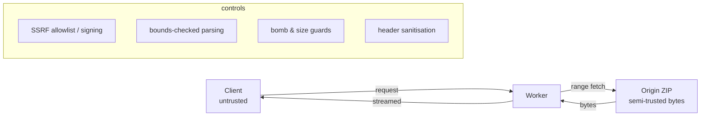

# Security

Archwright fetches attacker-influenceable URLs (in multi-archive mode) and parses
attacker-influenceable bytes (any ZIP). This document describes the threat model
and the controls. To report a vulnerability, see [SECURITY.md](../SECURITY.md).

## Trust boundaries

- **Client input** (path, headers, archive ref): fully untrusted.
- **Origin bytes** (the ZIP): treated as potentially malformed or malicious.

## Controls

### SSRF — Server-Side Request Forgery

`src/security/ssrf.ts` validates every archive URL before it is fetched:

- Only `http`/`https`; embedded credentials (`user:pass@`) rejected.
- **Host allowlist** (`ALLOWED_ARCHIVE_HOSTS`) — the authoritative gate in
  multi-archive mode, and defence-in-depth in single-archive mode (the
  `ARCHIVE_URL` host is auto-added).
- **Private/reserved IP-literal blocking** regardless of allowlist:
  loopback, RFC 1918, link-local (incl. `169.254.169.254` cloud metadata),
  CGNAT, `::1`, ULA/link-local IPv6, and IPv4-mapped IPv6.
- **No open proxy (by default):** multi-archive mode refuses to serve unless an
  allowlist **or** a signing secret is configured. Setting
  `ALLOW_ANY_ARCHIVE_HOST=true` is an explicit opt-in to fetch any **public** host
  (private/reserved IPs remain blocked) — it powers the "paste any link" UI but
  makes the Worker a public proxy, so prefer an allowlist or signed links for
  locked-down deployments.

> Limitation: allowlisting is by hostname and cannot see post-DNS resolution
> (DNS rebinding). Keep the allowlist to trusted object-storage hosts. See
> [Limitations](limitations.md).

### Signed references

`src/security/signing.ts` issues HMAC-SHA256 tokens (`base64url(payload).base64url(sig)`)
verified with the constant-time Web Crypto `verify`. Tokens can carry an expiry.
This lets you hand untrusted callers tamper-proof, short-lived links without an
allowlist and without exposing a proxy.

### ZIP bombs & resource exhaustion

- **Constant memory:** bodies always stream and are never buffered, so a bomb
  cannot exhaust the isolate's 128 MB — the amplification just produces a large
  stream the client downloads.
- **CPU bound by input:** we only feed the entry's compressed bytes to the
  inflater (single-stream DEFLATE amplifies at most ~1032×), and cap output at
  the declared uncompressed size.
- **Optional guards** (`MAX_UNCOMPRESSED_BYTES`, `MAX_COMPRESSION_RATIO`) reject
  implausible entries up-front, using only trusted central-directory metadata,
  bounding CPU and egress.

### Path traversal & entry spoofing

- The Worker never touches a filesystem; it serves only names present in the
  central-directory index, so traversal has nothing to escape to.
- Requested paths are percent-decoded, `\`→`/` folded, NFC-normalised, and
  rejected if they contain `..` segments, NUL, or control characters.
- Duplicate names in the central directory resolve **first-wins**, neutralising
  the "two entries, same name, different data" ambiguity.

### Header injection & response splitting

- Filenames in `Content-Disposition` are stripped of control characters and
  RFC 5987-encoded; an ASCII fallback is always provided.
- Client-supplied `x-request-id` is echoed only if it matches a strict token
  pattern; otherwise a UUID is generated.

### Cache poisoning

- Cache keys are derived solely from the archive URL and its origin validator
  (ETag/Last-Modified) — never from untrusted request headers.
- A changed archive changes the key, so stale indexes are never served.

### Malformed archives

- Every field read goes through `ByteView`, which bounds-checks and throws a
  caught `RangeError` rather than reading adjacent memory.
- EOCD/central-directory/local-header parsing validates signatures and offsets;
  failures return `502 malformed_archive`, never a crash.
- Multi-disk (spanned) and encrypted entries are refused explicitly.

### Unicode

- Names are decoded per the spec (Unicode Path extra field → UTF-8 flag → CP437)
  and NFC-normalised so a single entry cannot be addressed two ways.

## Hardening checklist for operators

- [ ] Set `ALLOWED_ARCHIVE_HOSTS` (or use signed refs) — required for multi-archive.
- [ ] Set `MAX_UNCOMPRESSED_BYTES` / `MAX_COMPRESSION_RATIO` if you accept
      untrusted archives.
- [ ] Restrict `CORS_ALLOW_ORIGIN` to your front-end origins if the API is not
      meant to be public.
- [ ] Prefer HTTPS origins; keep the allowlist minimal.
- [ ] Put Archwright behind Cloudflare WAF / rate limiting for public deployments.
